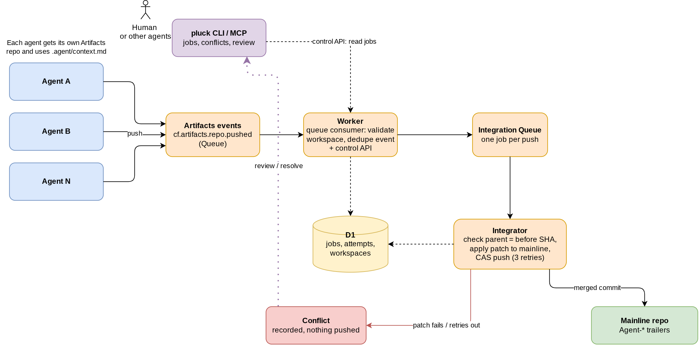

# Pluck

Pluck lets coding agents work concurrently in isolated Cloudflare Artifacts repositories and integrates their changes into a shared mainline. Agents use normal Git; Pluck handles event delivery, conflict-safe integration, and per-change provenance.

Inspired by Cloudflare's [Artifacts Git platform](https://blog.cloudflare.com/next-git-platform-on-cloudflare/). Independently authored, MIT licensed.

## How it works



1. Each agent gets its own Artifacts repository (workspace) and pushes a single linear commit to `main`, including `.agent/context.md` explaining the change.
2. Artifacts delivers a native `cf.artifacts.repo.pushed` event to a Queue. No webhook, no submit step.
3. The consumer validates the workspace, dedupes the event in D1, and enqueues an integration job.
4. The integrator requires a single commit whose parent matches the push `before` SHA, applies its diff to current mainline, and requires `.agent/context.md`.
5. On success it pushes a new mainline commit with `Agent-Task`, `Agent-Workspace`, `Agent-Source-Commit`, and `Agent-Context` trailers. The push is never forced; a non-fast-forward rejection triggers a re-read and retry (3 attempts, each recorded in D1).
6. If the patch does not apply or retries are exhausted, the job is recorded as a `conflict` and nothing is pushed.

## Quickstart

Requires a Workers Paid plan with Artifacts access, Node.js, Git, and either `npx wrangler login` or a `CLOUDFLARE_API_TOKEN`.

```sh
npm install
npx wrangler login
npm run pluck -- init --name my-pluck
```

`init` creates or reuses an Artifacts namespace, mainline repo, D1 database, and two Queues; seeds mainline; applies migrations; deploys the Worker; and writes:

- `.pluck/my-pluck.wrangler.jsonc` (non-secret config)
- `.pluck/my-pluck.env` (ignored, mode 0600: URL, control/owner tokens, namespace, mainline name)

The CLI loads the `.env` automatically when there is only one deployment; otherwise set `PLUCK_CONFIG`. Rerun with the same name to reuse resources. `CLOUDFLARE_API_TOKEN` is reused as the runtime subscription-management secret, or you are prompted for `PLUCK_RUNTIME_CLOUDFLARE_API_TOKEN`.

Unattended setup: `--yes --name my-pluck` with `CLOUDFLARE_API_TOKEN`. Optionally set `PLUCK_API_TOKEN`, `BOOTSTRAP_TOKEN`, `PLUCK_OWNER_TOKEN` for stable values, and `CLOUDFLARE_ACCOUNT_ID` if Wrangler can't infer the account.

## Try it: concurrent agents demo

After `init`, one command runs the whole story:

```sh
npm run demo            # 6 scripted agents; or: npm run demo -- 12 --keep
```

### LLM mode

`--llm` makes every agent a real model call instead of a scripted change. Each agent receives a small task, writes its own files plus an `.agent/context.md` explaining why, and pushes. Two agents are given the same task so they collide. Any OpenAI-compatible chat completions API works:

```sh
export LLM_API_KEY=...                       # keep it in your local .env
export LLM_MODEL=gpt-4o-mini                 # any model your endpoint serves
export LLM_BASE_URL=https://api.openai.com/v1   # optional; point at any compatible provider
npm run demo -- 6 --llm
```

Unusable model output is retried once, then that agent falls back to the scripted change. Agents can also drive Pluck directly through the [MCP server](docs/mcp.md).

It creates one Artifacts workspace per agent, has all agents commit and push at the same time, and prints a live timeline as Pluck integrates each push into mainline. Independent changes all land (racing pushes are resolved by CAS retry); two agents that write the same file collide, so one is recorded as a `conflict`. It ends by printing mainline history with the `Agent-*` provenance trailers. Resolve the conflict with `npm run pluck -- review <job-id>`. Workspaces are removed afterwards unless `--keep` is set.

## Demo (manual): two agents, one conflict

```sh
npm run pluck -- create agent-a
npm run pluck -- create agent-b
```

Each returns an Artifacts `remote` and short-lived Git `token`.

1. Clone both. In each, add `.agent/context.md`, edit the same lines of the same file, commit, push to `main`.
2. The first push integrates: `npm run pluck -- jobs` shows `integrated` and mainline gains a commit with `Agent-*` trailers.
3. The second is recorded as a `conflict` (`npm run pluck -- conflicts`); nothing is pushed.
4. `npm run pluck -- review <job-id>` clones mainline into a disposable worktree, cherry-picks the agent commit so you can resolve it with normal Git, and submits the resulting patch for the same validation. Use `--keep` to retain the worktree, `--no-editor` to skip `$EDITOR`. Review needs `PLUCK_NAMESPACE` and `PLUCK_MAINLINE_REPO`.

## CLI

```sh
npm run pluck -- jobs
npm run pluck -- status <job-id>
npm run pluck -- retry <job-id>
npm run pluck -- conflicts
npm run pluck -- review <job-id>
npm run pluck -- create <repo-name> [namespace]    # needs PLUCK_OWNER_TOKEN
npm run pluck -- delete <repo-name> [namespace]    # removes subscription, keeps the repo
npm run pluck -- destroy --name my-pluck --confirm my-pluck
```

`destroy` removes the Worker, mainline repo, D1 database, Queues, and generated config. Wrangler can't delete Artifacts namespaces, so the empty namespace is retained.

## Docs

- [HTTP API](docs/api.md)
- [MCP server](docs/mcp.md)

## Development

```sh
npm run typecheck
npm test
npm run probe
npm run db:migrate:local
npm run dev
```

`probe` reports whether the installed `isomorphic-git` exposes a patch API. The integrator fails closed if patch application isn't proven, so it never pushes a partially applied tree. Git writes use `isomorphic-git` with the Workers HTTP adapter and an in-memory filesystem.

## Live testing

Use `wrangler.test.jsonc`, which targets separate resources (`pluck-mcp-test` Worker, `pluck-test` namespace, `pluck-test-mainline` repo, `pluck-test` D1, `pluck-test-integration` and `pluck-test-artifacts-events` Queues). Create workspaces via `POST /admin/workspaces`, not by hand. A deployment targeting a repo named `mainline` is rejected unless `ALLOW_PRODUCTION_MAINLINE=true`.

Once the D1 ID and event queue ID are configured:

```sh
npm run db:migrate:test
npm run deploy:test
```
